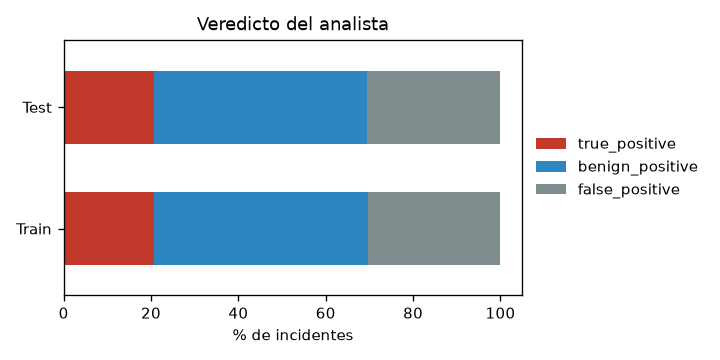
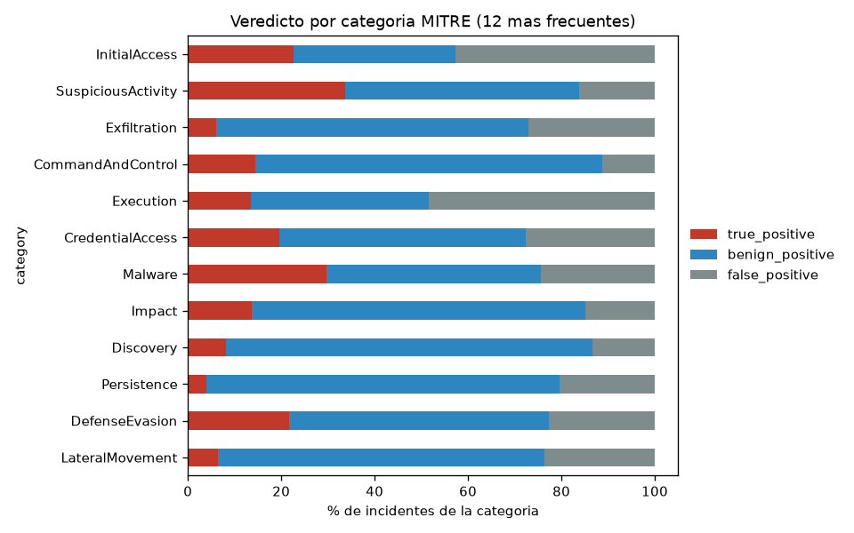
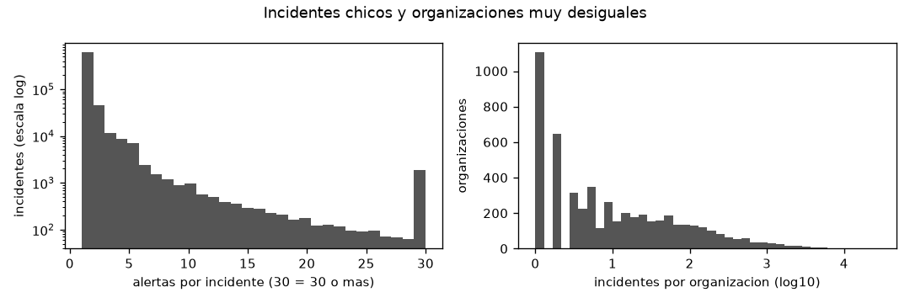
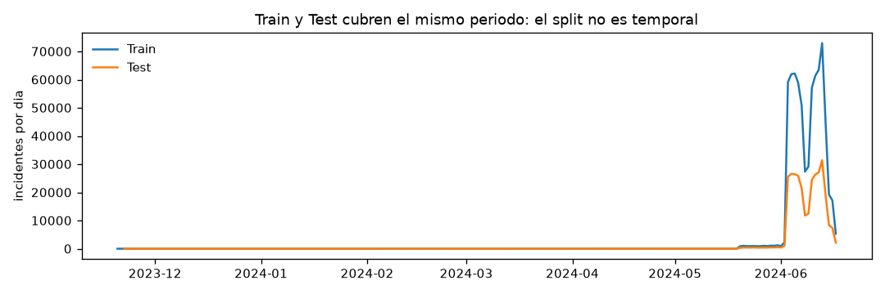
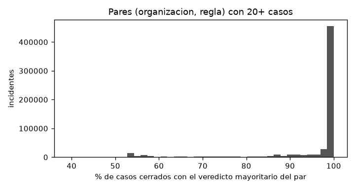

# Analisis exploratorio de GUIDE

Generado por `ml/eda_guide.py`. Cifras sobre los CSV originales (nivel evidencia) y sobre los incidentes agregados por `fortia_ml` (nivel incidente, solo con veredicto).

## 1. Estructura

| Archivo | Filas (evidencias) | Columnas | Incidentes | Desde | Hasta |
|---|---|---|---|---|---|
| Train | 9.516.837 | 45 | 730.778 | 2023-11-20 | 2024-06-17 |
| Test | 4.147.992 | 46 | 303.220 | 2023-11-22 | 2024-06-17 |

## 2. Calidad de datos

| Archivo | Filas identicas repetidas | Valores distintos de Id | Incidentes sin veredicto | % | Incidentes con 2+ veredictos | Incidentes con accion | % |
|---|---|---|---|---|---|---|---|
| Train | 22.559 | 730.778 | 23.670 | 3,2 % | 0 | 26.282 | 3,6 % |
| Test | 104 | 303.220 | 0 | 0,0 % | 0 | 1.149 | 0,4 % |

- Incidentes en Train y en Test a la vez: **0**.
- Organizaciones en ambos archivos: 4.021 (Train 5.340, Test 4.400).

### Nulos por columna (Train, % de filas)

| Columna | Train | Test |
|---|---|---|
| ResourceType | 99,9 % | 99,9 % |
| ActionGrouped | 99,4 % | 100,0 % |
| ActionGranular | 99,4 % | 100,0 % |
| ThreatFamily | 99,2 % | 99,2 % |
| EmailClusterId | 99,0 % | 99,0 % |
| AntispamDirection | 98,1 % | 98,2 % |
| Roles | 97,7 % | 97,4 % |
| SuspicionLevel | 84,8 % | 84,3 % |
| LastVerdict | 76,5 % | 76,1 % |
| MitreTechniques | 57,5 % | 55,6 % |
| IncidentGrade | 0,5 % | 0,0 % |

### Columnas anonimizadas: peso del valor de relleno (Train)

Valor mas frecuente de cada columna y % de filas que lo tienen. Un % alto indica que el campo casi nunca trae informacion (el anonimizador pone un mismo entero cuando no hay dato).

| Columna | Valor | % de filas |
|---|---|---|
| RegistryKey | 1631 | 99,8 % |
| OSVersion | 66 | 98,0 % |
| OSFamily | 5 | 98,0 % |
| ApplicationId | 2251 | 97,8 % |
| DeviceId | 98799 | 96,2 % |
| State | 1445 | 93,3 % |
| City | 10630 | 93,3 % |
| Url | 160396 | 92,8 % |
| DeviceName | 153085 | 92,7 % |
| Sha256 | 138268 | 92,3 % |
| CountryCode | 242 | 92,1 % |
| FolderPath | 117668 | 90,8 % |
| FileName | 289573 | 89,2 % |
| NetworkMessageId | 529644 | 87,8 % |
| IpAddress | 360606 | 77,1 % |
| AccountObjectId | 425863 | 76,6 % |
| AccountSid | 441377 | 76,3 % |
| AccountName | 453297 | 75,1 % |
| AccountUpn | 673934 | 63,6 % |

## 3. Etiquetas

| Veredicto | Train | Test |
|---|---|---|
| true_positive | 20,6 % | 20,6 % |
| benign_positive | 49,0 % | 48,9 % |
| false_positive | 30,4 % | 30,5 % |

- Organizaciones de Train con un solo veredicto en todos sus incidentes: 3.047 de 5.340.

## 4. Tamanos

- Alertas por incidente: mediana 1, p90 2, p99 9, maximo 5.371.
- Incidentes por organizacion: mediana 7, p90 188, maximo 28.522. Las 10 mas grandes concentran el 19,9 % de los incidentes.
- Reglas (DetectorId) distintas: 7.219. Las 20 mas frecuentes cubren el 67,4 % de los incidentes.

## 5. Tiempo

- Train: 2023-11-20 a 2024-06-17. Test: 2023-11-22 a 2024-06-17.
- Organizaciones comunes en las que Test empieza despues de que termina Train: 296 de 4.021.

## 6. De donde sale la senal

Para cada par (organizacion, regla) se mide que % de sus incidentes se cerro con el mismo veredicto.

| Acuerdo del par (20+ casos) | Incidentes | % de Train |
|---|---|---|
| >= 80 % | 550.996 | 77,9 % |
| >= 90 % | 522.975 | 74,0 % |
| >= 95 % | 494.030 | 69,9 % |
| >= 99 % | 421.176 | 59,6 % |
| >= 100 % | 339.100 | 48,0 % |

- Incidentes en pares con menos de 20 casos: 13,3 %.

## 7. Conteos a nivel evidencia (Train)

**EntityType**

| Valor | Filas | % |
|---|---|---|
| Ip | 2.181.194 | 22,9 % |
| User | 1.932.416 | 20,3 % |
| MailMessage | 1.173.154 | 12,3 % |
| Machine | 699.208 | 7,3 % |
| File | 688.402 | 7,2 % |
| Url | 682.578 | 7,2 % |
| CloudLogonRequest | 638.565 | 6,7 % |
| Mailbox | 483.158 | 5,1 % |

**EvidenceRole**

| Valor | Filas | % |
|---|---|---|
| Related | 5.208.644 | 54,7 % |
| Impacted | 4.308.193 | 45,3 % |

**LastVerdict**

| Valor | Filas | % |
|---|---|---|
| (vacio) | 7.282.572 | 76,5 % |
| Suspicious | 1.402.997 | 14,7 % |
| Malicious | 433.359 | 4,6 % |
| NoThreatsFound | 397.718 | 4,2 % |
| DomainPII_50d8b4a941c26b89482c94ab324b5a274f9ced66 | 128 | 0,0 % |
| DomainPII_9207384283ce115db5a590dd9ca5de21e5e99df2 | 63 | 0,0 % |

**SuspicionLevel**

| Valor | Filas | % |
|---|---|---|
| (vacio) | 8.072.708 | 84,8 % |
| Suspicious | 1.442.614 | 15,2 % |
| Incriminated | 1.515 | 0,0 % |

**ActionGrouped**

| Valor | Filas | % |
|---|---|---|
| (vacio) | 9.460.773 | 99,4 % |
| ContainAccount | 53.760 | 0,6 % |
| IsolateDevice | 2.237 | 0,0 % |
| Stop Virtual Machines | 67 | 0,0 % |
