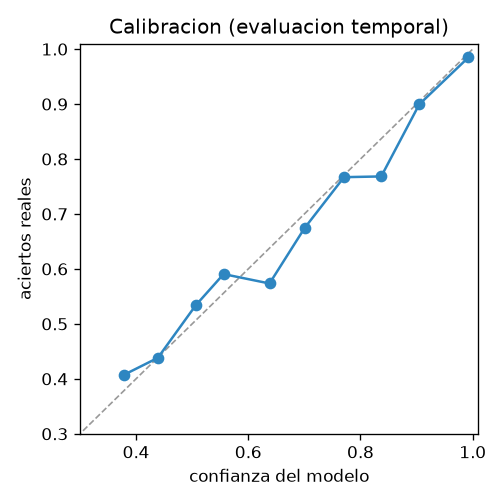
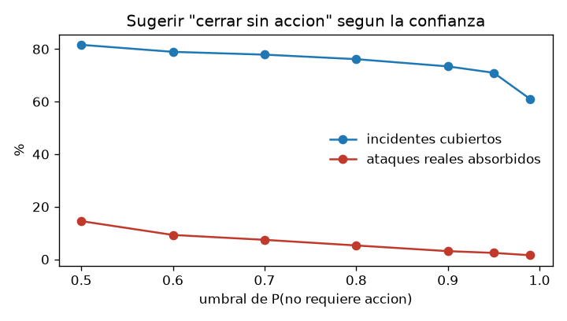

# Robustez de la fase 1

Generado por `python -m fortia_ml.robustness`. Evaluacion temporal salvo que se indique otra: dentro de cada organizacion, el primer 70 % de sus incidentes entrena y el resto evalua. Intervalos del 95 % por bootstrap de organizaciones (1000 remuestreos).

## 1. Macro-F1 con intervalo de confianza

| Predictor | Macro-F1 | IC 95 % |
|---|---|---|
| Mayoritaria | 0,219 | 0,194 a 0,239 |
| Tabla | 0,912 | 0,888 a 0,930 |
| Modelo | 0,915 | 0,892 a 0,932 |
| Modelo menos tabla | 0,0035 | 0,001 a 0,006 |

Si el intervalo de "modelo menos tabla" no incluye el 0, la diferencia no es azar del muestreo de organizaciones. Eso no la vuelve grande.

## 2. Semillas

| Semilla | Macro-F1 del modelo |
|---|---|
| 0 | 0,9154 |
| 1 | 0,9155 |
| 2 | 0,9153 |

## 3. Politicas por organizacion (N = 20, X = 95 %)

| Cifra | Valor | IC 95 % |
|---|---|---|
| Cerrar sin accion: cobertura | 58,8 % | 52,5 % a 65,0 % |
| Cerrar sin accion: precision | 99,6 % | 99,3 % a 99,8 % |
| Ataques reales absorbidos | 1,3 % | 0,6 % a 2,2 % |

## 4. Calibracion

Error de calibracion esperado (ECE): 0,0113. Brier multiclase: 0,1076. Un ECE cerca de 0 significa que la confianza que mostraria la app se puede leer como probabilidad de acierto.

| Confianza | Incidentes | Confianza media | Aciertos |
|---|---|---|---|
| 0,33-0,40 | 1448 | 37,9 % | 40,7 % |
| 0,40-0,47 | 3471 | 43,9 % | 43,8 % |
| 0,47-0,53 | 6005 | 50,6 % | 53,4 % |
| 0,53-0,60 | 12602 | 55,6 % | 59,1 % |
| 0,60-0,67 | 4924 | 63,8 % | 57,4 % |
| 0,67-0,73 | 6093 | 70,0 % | 67,4 % |
| 0,73-0,80 | 6574 | 77,1 % | 76,7 % |
| 0,80-0,87 | 5809 | 83,7 % | 76,8 % |
| 0,87-0,93 | 14462 | 90,5 % | 89,9 % |
| 0,93-1,00 | 244480 | 99,2 % | 98,5 % |

## 5. Punto de operacion

| Umbral | Sugiere veredicto | Precision | Sugiere cerrar | Precision | TP absorbidos |
|---|---|---|---|---|---|
| 0,50 | 97,8 % | 93,6 % | 81,6 % | 96,5 % | 14,5 % |
| 0,60 | 92,3 % | 95,7 % | 78,9 % | 97,7 % | 9,3 % |
| 0,70 | 89,7 % | 96,8 % | 77,9 % | 98,1 % | 7,4 % |
| 0,80 | 86,6 % | 97,5 % | 76,2 % | 98,6 % | 5,3 % |
| 0,90 | 83,1 % | 98,2 % | 73,4 % | 99,2 % | 3,1 % |
| 0,95 | 78,4 % | 98,6 % | 71,0 % | 99,3 % | 2,4 % |
| 0,99 | 60,7 % | 99,0 % | 60,9 % | 99,5 % | 1,5 % |

## 6. Que ataques absorben las politicas

Ataques reales que una politica "cerrar sin accion" cerraria, comparados con todos los ataques reales.

**category**

| Valor | Absorbidos | % de absorbidos | % de todos los TP | Tasa de absorcion |
|---|---|---|---|---|
| InitialAccess | 324 | 42,9 % | 46,1 % | 1,2 % |
| Exfiltration | 155 | 20,5 % | 3,8 % | 6,7 % |
| SuspiciousActivity | 132 | 17,5 % | 32,3 % | 0,7 % |
| CommandAndControl | 58 | 7,7 % | 7,7 % | 1,3 % |
| Malware | 44 | 5,8 % | 2,4 % | 3,0 % |
| LateralMovement | 19 | 2,5 % | 0,2 % | 19,6 % |
| Execution | 7 | 0,9 % | 3,4 % | 0,3 % |
| CredentialAccess | 6 | 0,8 % | 2,2 % | 0,5 % |

**dominant_entity**

| Valor | Absorbidos | % de absorbidos | % de todos los TP | Tasa de absorcion |
|---|---|---|---|---|
| Ip | 465 | 61,6 % | 47,2 % | 1,6 % |
| User | 91 | 12,1 % | 16,4 % | 0,9 % |
| Url | 60 | 7,9 % | 14,4 % | 0,7 % |
| Machine | 50 | 6,6 % | 3,1 % | 2,7 % |
| File | 47 | 6,2 % | 3,3 % | 2,4 % |
| MailMessage | 39 | 5,2 % | 12,6 % | 0,5 % |
| CloudApplication | 1 | 0,1 % | 0,9 % | 0,2 % |
| Process | 1 | 0,1 % | 0,4 % | 0,4 % |

**alert_bucket**

| Valor | Absorbidos | % de absorbidos | % de todos los TP | Tasa de absorcion |
|---|---|---|---|---|
| 1 | 714 | 94,6 % | 86,3 % | 1,4 % |
| 2-5 | 35 | 4,6 % | 11,2 % | 0,5 % |
| 6+ | 6 | 0,8 % | 2,5 % | 0,4 % |

## 7. Corte por fecha (2024-06-10)

Entrena con todo lo anterior al 2024-06-10 (522.379 incidentes) y evalua lo posterior (487.949).

| Predictor | Macro-F1 |
|---|---|
| Mayoritaria | 0,213 |
| Tabla | 0,901 |
| Modelo | 0,904 |

- Par (org, regla) ya visto en el entrenamiento: 93,6 % de la evaluacion.
- Politicas por org: cobertura 55,2 %, precision 99,7 %, ataques absorbidos 1,0 %.

## 8. Tuneo acotado

Validacion interna: dentro del pasado, el ultimo 20 % de cada organizacion valida. La evaluacion no se usa para elegir.

| Parametros | Macro-F1 validacion | Iteraciones | Segundos |
|---|---|---|---|
| {"learning_rate": 0.05, "max_iter": 300, "max_leaf_nodes": 31} | 0,9187 | 300 | 159 |
| {"learning_rate": 0.05, "max_iter": 300, "max_leaf_nodes": 63} | 0,9187 | 252 | 150 |
| {"learning_rate": 0.1, "max_iter": 100, "max_leaf_nodes": 31} | 0,9186 | 100 | 74 |
| por defecto | 0,9186 | 100 | 181 |
| {"learning_rate": 0.05, "max_iter": 100, "max_leaf_nodes": 31} | 0,9185 | 100 | 109 |
| {"learning_rate": 0.1, "max_iter": 100, "max_leaf_nodes": 63} | 0,9184 | 100 | 95 |
| {"learning_rate": 0.1, "max_iter": 300, "max_leaf_nodes": 63} | 0,9184 | 115 | 76 |
| {"learning_rate": 0.1, "max_iter": 300, "max_leaf_nodes": 31} | 0,9183 | 148 | 85 |
| {"learning_rate": 0.05, "max_iter": 100, "max_leaf_nodes": 63} | 0,9181 | 100 | 100 |
| {"learning_rate": 0.2, "max_iter": 100, "max_leaf_nodes": 63} | 0,9173 | 34 | 17 |
| {"learning_rate": 0.2, "max_iter": 300, "max_leaf_nodes": 63} | 0,9173 | 34 | 14 |
| {"learning_rate": 0.2, "max_iter": 100, "max_leaf_nodes": 31} | 0,9165 | 48 | 42 |
| {"learning_rate": 0.2, "max_iter": 300, "max_leaf_nodes": 31} | 0,9165 | 48 | 15 |
| {"class_weight": "balanced"} | 0,9142 | 100 | 23 |

- Elegido: {"learning_rate": 0.05, "max_iter": 300, "max_leaf_nodes": 31}.
- Macro-F1 en la evaluacion temporal: 0,9157 (por defecto 0,9154).
